# 🔬 SpectraMatch — Multimodal Chemometric Identification Platform

[](https://www.python.org/downloads/)
[](https://opensource.org/licenses/MIT)
[](https://github.com/astral-sh/ruff)
[](https://github.com/xav1c34/SpectraMatch/actions)
[](tests/)
[](https://spectramatch.streamlit.app)

**SpectraMatch** is an open-source, high-throughput analytical chemometrics platform designed for the rapid identification, fingerprinting, and biogeochemical profiling of complex **Natural / Dissolved Organic Matter (NOM/DOM)**, environmental reference isolates (IHSS standards), and technical lignins.

It unifies three foundational yet heterogeneous instrumental analytical modalities into a single canonical mathematical framework:
1. **FTIR Spectroscopy** (1D continuous vibrational absorption, 400–4000 cm⁻¹);
2. **EEM Fluorescence** (2D excitation-emission optical matrices, Ex 240–450 nm / Em 280–600 nm);
3. **FT-ICR Mass Spectrometry** (Ultra-high-resolution discrete mass peak lists, 150–800 Da).

🌐 **Live Cloud Demo:** [https://spectramatch.streamlit.app](https://spectramatch.streamlit.app)

---

## 📑 Table of Contents

- [⚡ Key Highlights](#-key-highlights)
- [🖥️ Interactive Web Interface & Views](#️-interactive-web-interface--views)
- [🏗️ System Architecture](#️-system-architecture)
- [📐 Mathematical Rigor & Chemometric Metrics](#-mathematical-rigor--chemometric-metrics)
- [📊 High-Throughput Performance Benchmarks](#-high-throughput-performance-benchmarks)
- [🚀 Quickstart & Installation](#-quickstart--installation)
- [🐳 Docker Containerization](#-docker-containerization)
- [🧪 Testing & Invariant Verification](#-testing--invariant-verification)
- [📁 Repository Structure](#-repository-structure)
- [🎓 Academic Portfolio Snippet & Citation](#-academic-portfolio-snippet--citation)
- [📜 License](#-license)

---

## ⚡ Key Highlights

- **Sub-millisecond Vector Querying:** Zero-latency retrieval via vectorized matrix-vector BLAS operations across pre-indexed NumPy arrays (`vectors.npz`).
- **Chemical Space Explorer (PCA Mapping):** Real-time SVD dimensionality reduction projecting query spectra onto principal component axes (PC1 vs PC2) alongside classified reference clusters.
- **Kendrick Mass Defect (KMD) Analysis:** High-resolution mass defect profiling for FT-ICR MS against homologous $-\text{CH}_2-$ series, isolating alkylation and anthropogenic surfactants.
- **Native IUPAC JCAMP-DX Support:** Resilient parser for `.jdx` / `.dx` files from Bruker, PerkinElmer, and Shimadzu instruments.
- **Batch Expedition Screening:** Mass multi-file and `.zip` screening with summary QC breakdowns, class distribution pie charts, and master CSV exports.
- **Interactive Simulator Sandbox:** Real-time forward modeling of functional absorption bands and fluorescence contours with instant parameter updates.
- **Domain-Specific Mathematical Metrics:**
  - *Pearson Correlation Coefficient ($r$):* Centered similarity invariant to additive baseline offset (ideal for FTIR).
  - *Tucker Congruence Coefficient (TCC):* The OpenFluor biogeochemical standard for 2D fluorescence matrices, evaluating excitation and emission profiles independently.
  - *Cosine & Euclidean Similarity:* Optimized dot products for discrete binned mass spectra.
- **Automated Physical & Instrumental Preprocessing:**
  - *Asymmetric Least Squares (AsLS)* iterative baseline correction ($\lambda=10^6, p=0.01$).
  - *Delaunay 2D interpolation* for 1st & 2nd order Rayleigh scattering artifact excision.
  - *High-resolution mass binning* (0.5 Da channels across 150–800 Da).
- **Automated Analytical Quality Control (QC Suite):**
  - Instant scoring (0.0 to 1.0) and visual badges (🟢/🟡/🔴) evaluating data density, spectral coverage, silent-region SNR, negative intensity fractions, and detector saturation.
- **Biogeochemical Descriptors:**
  - Automatic extraction of FTIR functional ratios ($LI, AI, CI, Aliph/Arom$), fluorescence indices ($FI, HIX, BIX$, Coble Peaks A, C, M, T, B), and FT-ICR MS molecular mass parameters ($\bar{M}_w, \bar{M}_n, PD$, LMW/MMW/HMW pools).
- **Three-Tier Export Engine:**
  - Ranked CSV candidate table;
  - JSON Analytical Sample Passport (`spectral_passport.json`);
  - Self-contained interactive HTML reports with embedded Plotly visualizations.

---

## 🖥️ Interactive Web Interface & Views

The platform provides 7 specialized scientific interfaces accessible from the sidebar navigation:

| View | Purpose & Functionality |
|:---|:---|
| **🔍 Search & Match** | Drag-and-drop spectrum ingestion, automated modality autodetection, 6-point QC badge, interactive Plotly overlays with residual subplots ($\Delta$), PCA chemical space projection, KMD mass defect charts, and multi-format export. |
| **📦 Batch Screening** | Multi-file and ZIP archive processor for large environmental surveys and expedition series with batch QC scoring and master export. |
| **📋 Catalog Browser** | Filterable database explorer (~50 reference spectra including IHSS standards, lake DOM, and technical lignins) with metadata, computed indices, and raw CSV download. |
| **⚖️ 1-to-1 Compare** | Direct pairwise comparison between two arbitrary experimental files computing all 4 similarity metrics simultaneously. |
| **➕ Add to Library** | Ingestion form enabling researchers to expand the local catalog with custom measured spectra and dynamically update RAM vector matrices. |
| **🎛️ Simulator Sandbox** | Chemometric forward modeling sandbox with interactive sliders for functional group amplitudes, Coble fluorophores, and mass distributions. |
| **📖 Theory & Formulas** | Complete biogeochemical documentation, analytical wavelength bands, and mathematical definitions with LaTeX equations. |

---

## 🏗️ System Architecture

```mermaid
flowchart TD
    subgraph UI ["Presentation Layer (Streamlit + Plotly)"]
        APP["app.py (State Manager & Session Router)"]
        SEARCH["views/search_view.py (Search, Overlays & Reporting)"]
        BATCH["views/batch_view.py (Batch Screening Engine)"]
        BROWSE["views/browse_view.py (Catalog Explorer & Inspector)"]
        COMPARE["views/compare_view.py (Direct 1-to-1 Binary Comparison)"]
        ADD["views/add_view.py (Dynamic Catalog Expander)"]
        SIMU["views/generator_view.py (Forward Modeling Sandbox)"]
        ABOUT["views/about_view.py (Theory & Documentation)"]
    end

    subgraph Core ["Computational Chemometric Engine"]
        INGEST["core/ingest.py (Multi-format, Cascade Encoding & Sniffer)"]
        JCAMP["core/jcamp.py (IUPAC JCAMP-DX .jdx Parser)"]
        NORM["core/normalize.py (AsLS Baseline, Gridding & Normalization)"]
        SIM["core/similarity.py (Cosine, Pearson, Euclidean, TCC Search)"]
        QC["core/qc.py (6-Stage Analytical Quality Control)"]
        IDX["core/indices.py (Biogeochemical Index Calculator)"]
        CHEM["core/chemspace.py (PCA Chemical Space SVD Engine)"]
        KMD["core/kendrick.py (Kendrick Mass Defect Calculator)"]
        SYNTH["core/synthetic.py (Gaussian Superposition Model)"]
        MODELS["core/models.py (Strict Dataclass Contracts)"]
    end

    subgraph Data ["Data & Indexing Layer"]
        DB["db/database.py (SQLite Spectral Catalog)"]
        SEED["library/seed.py (Catalog & Vector Builder)"]
        VECTORS["library/vectors.npz (RAM Matrix Index)"]
        SQL["db/spectramatch.db (Metadata & Precomputed Indices)"]
    end

    APP --> SEARCH & BATCH & BROWSE & COMPARE & ADD & SIMU & ABOUT
    SEARCH --> INGEST & SIM & QC & IDX & CHEM & KMD
    BATCH --> INGEST & SIM & QC
    COMPARE --> INGEST & SIM & IDX
    ADD --> INGEST & DB & VECTORS
    INGEST --> JCAMP & NORM
    SEED --> SYNTH & NORM & IDX & DB & VECTORS
    APP -.-> VECTORS & SQL
```



---

## 📐 Mathematical Rigor & Chemometric Metrics

### 1. Pearson Correlation (FTIR Default)
$$\mathcal{S}_{\text{pearson}}(\mathbf{q}, \mathbf{r}) = \frac{\sum_{i=1}^D (q_i - \bar{q})(r_i - \bar{r})}{\sqrt{\sum_{i=1}^D (q_i - \bar{q})^2} \sqrt{\sum_{i=1}^D (r_i - \bar{r})^2}}$$
*Advantage:* Subtracting mean intensities ensures that residual optical baseline shifts do not penalize identity matching.

### 2. Tucker Congruence Coefficient (EEM Default)
$$\text{TCC}(\mathbf{Q}, \mathbf{R}) = \min \left( \frac{\mathbf{q}_{ex} \cdot \mathbf{r}_{ex}}{\|\mathbf{q}_{ex}\|_2 \|\mathbf{r}_{ex}\|_2}, \, \frac{\mathbf{q}_{em} \cdot \mathbf{r}_{em}}{\|\mathbf{q}_{em}\|_2 \|\mathbf{r}_{em}\|_2} \right)$$
Where $\mathbf{q}_{ex} = \sum_{em} Q_{ex, em}$ and $\mathbf{q}_{em} = \sum_{ex} Q_{ex, em}$. Both excitation and emission projections must concur for a positive match.

### 3. Asymmetric Least Squares (AsLS) Baseline
$$\min_{\mathbf{z}} \sum_i w_i (y_i - z_i)^2 + \lambda \sum_i (\Delta^2 z_i)^2, \quad w_i = \begin{cases} p, & y_i > z_i \\ 1 - p, & y_i \le z_i \end{cases}$$
Implemented using sparse Cholesky matrix decomposition (`scipy.sparse.linalg.spsolve`), executing in $< 25$ ms.

### 4. Kendrick Mass Defect (KMD for FT-ICR MS)
$$\text{KM} = m/z \times \frac{14.00000}{14.01565}, \quad \text{NKM} = \text{round}(\text{KM}), \quad \text{KMD} = \text{NKM} - \text{KM}$$
Aligns $-\text{CH}_2-$ homologous series on horizontal trajectories to isolate alkylation patterns.

---

## 📊 High-Throughput Performance Benchmarks

Benchmarked on desktop standard architecture (`benchmark.py`):

| Modality / Task | Metric & Dimension | Library Size ($N$) | Latency per Query | Throughput |
|:---|:---|:---:|:---:|:---:|
| **FT-ICR MS** | Cosine ($D=1300$) | $1\,000$ | **6.90 ms** | **144.9 QPS** |
| **FT-ICR MS** | Cosine ($D=1300$) | $10\,000$ | **61.40 ms** | **16.3 QPS** |
| **FTIR** | Pearson ($D=1801$) | $1\,000$ | **13.30 ms** | **75.2 QPS** |
| **FTIR** | Pearson ($D=1801$) | $5\,000$ | **67.19 ms** | **14.9 QPS** |
| **EEM Fluorescence** | Tucker Congruence ($D=6923$) | $1\,000$ | **26.31 ms** | **38.0 QPS** |
| **AsLS Baseline Correction** | 10 Iterations Sparse Solve ($D=1801$) | 1 Spectrum | **21.40 ms** | **46.7 Spectra/s** |

All single-query operations execute well below the 100 ms interactivity threshold.

---

## 🚀 Quickstart & Installation

### 1. Clone & Set Up Environment
```bash
git clone https://github.com/xav1c34/SpectraMatch.git
cd SpectraMatch
python -m venv venv
source venv/bin/activate  # On Windows: venv\Scripts\activate
pip install -r requirements.txt
```

### 2. Precompute Reference Catalog (Seed)
Generate canonical matrix representations and initialize the local SQLite database:
```bash
python library/seed.py
```

### 3. Launch the Application
```bash
streamlit run app.py
```
Open your browser at `http://localhost:8501`.

---

## 🐳 Docker Containerization

Deploy SpectraMatch with Docker and Docker Compose in one command:

```bash
docker compose up --build
```
Access the application at `http://localhost:8501`.

---

## 🧪 Testing & Invariant Verification

The comprehensive test suite covers mathematical symmetry, metric identity, unit L2 scaling, AsLS baseline elimination, Delaunay Rayleigh interpolation, JCAMP-DX decoding, and PCA projections:

```bash
pytest -v
```

Expected output:
```
tests/test_chemspace_and_kendrick.py::test_pca_fitting_and_projection PASSED [  3%]
tests/test_chemspace_and_kendrick.py::test_kendrick_mass_defect PASSED       [  7%]
tests/test_indices.py::test_ftir_indices PASSED                              [ 11%]
tests/test_indices.py::test_eem_indices PASSED                               [ 15%]
tests/test_indices.py::test_fticr_indices PASSED                             [ 19%]
tests/test_ingest.py::test_ingest_standard_csv PASSED                        [ 23%]
tests/test_ingest.py::test_ingest_european_semicolon_format PASSED           [ 26%]
tests/test_ingest.py::test_modality_detection PASSED                         [ 30%]
tests/test_jcamp.py::test_is_jcamp PASSED                                    [ 34%]
tests/test_jcamp.py::test_parse_jcamp PASSED                                 [ 38%]
tests/test_jcamp.py::test_ingest_jcamp_file PASSED                           [ 42%]
tests/test_normalize.py::test_ftir_normalization_invariants PASSED           [ 46%]
tests/test_normalize.py::test_asls_baseline_offset_removal PASSED            [ 50%]
tests/test_normalize.py::test_eem_normalization_invariants PASSED            [ 53%]
tests/test_normalize.py::test_fticr_normalization_invariants PASSED          [ 57%]
tests/test_normalize.py::test_empty_spectrum_raises_exception PASSED         [ 61%]
tests/test_qc.py::test_qc_normal_spectrum_passes PASSED                      [ 65%]
tests/test_qc.py::test_qc_empty_spectrum_fails PASSED                        [ 69%]
tests/test_qc.py::test_qc_too_few_points_fails PASSED                        [ 73%]
tests/test_qc.py::test_qc_low_coverage_warning PASSED                        [ 76%]
tests/test_search.py::test_self_identification_rank1 PASSED                  [ 80%]
tests/test_search.py::test_noisy_query_robustness PASSED                     [ 84%]
tests/test_similarity.py::test_metric_identity_invariants PASSED             [ 88%]
tests/test_similarity.py::test_metric_symmetry_invariants PASSED             [ 92%]
tests/test_similarity.py::test_tcc_similarity_properties PASSED              [ 96%]
tests/test_similarity.py::test_batch_equivalence PASSED                      [100%]
============================== 26 passed in 2.87s ==============================
```

---

## 📁 Repository Structure

```
SpectraMatch/
├── app.py                         # Main Streamlit orchestration & session router
├── requirements.txt               # Production dependencies
├── benchmark.py                   # High-throughput benchmarking script
├── demo_walkthrough.ipynb         # Interactive Jupyter Notebook demonstration
├── Dockerfile                     # Multi-stage production container definition
├── docker-compose.yml             # Single-command container deployment
├── LICENSE                        # MIT License
├── README.md                      # Comprehensive scientific documentation
├── spectramatch_tz.md             # Complete Technical Specification (ТЗ)
├── .github/
│   └── workflows/
│       └── tests.yml              # CI/CD multi-version matrix (Python 3.10–3.13)
├── .streamlit/
│   └── config.toml                # Scientific UI theme configuration
├── core/
│   ├── __init__.py
│   ├── models.py                  # Strict dataclass schemas & Enums
│   ├── normalize.py               # AsLS baseline, Delaunay Rayleigh removal, L2 gridding
│   ├── similarity.py              # Vectorized Cosine, Pearson, Euclidean, TCC search
│   ├── qc.py                      # 6-point analytical quality control suite
│   ├── indices.py                 # Chemometric & biogeochemical index engine
│   ├── chemspace.py               # SVD Principal Component Analysis (PCA) mapping
│   ├── kendrick.py                # Kendrick Mass Defect (KMD) series analysis
│   ├── jcamp.py                   # IUPAC JCAMP-DX (.jdx) spectroscopic parser
│   ├── synthetic.py               # Ground-truth Gaussian superposition generator
│   └── ingest.py                  # Robust multi-format & encoding sniffer
├── db/
│   ├── __init__.py
│   ├── database.py                # SQLite catalog interface
│   └── spectramatch.db            # SQLite database with indexed catalog
├── library/
│   ├── metadata.json              # Reference sample descriptions (IHSS, Baikal, etc.)
│   ├── seed.py                    # Pre-computation build pipeline
│   ├── vectors.npz                # In-memory compressed vector index
│   └── spectra/                   # Raw exported CSV reference spectra
├── views/
│   ├── __init__.py
│   ├── search_view.py             # Main Search & Retrieval view
│   ├── batch_view.py              # Batch screening view for multi-file series
│   ├── browse_view.py             # Library catalog browser & inspector
│   ├── compare_view.py            # Direct 1-to-1 sample comparison view
│   ├── add_view.py                # User sample ingestion tool
│   ├── generator_view.py          # Interactive forward modeling sandbox
│   ├── about_view.py              # Theoretical documentation & mathematical formulas
│   ├── plot_utils.py              # Plotly scientific overlays, heatmaps, & mirror charts
│   └── export_utils.py            # CSV, JSON passport, and standalone HTML exporters
├── user_spectra/                  # Demo files (FTIR, EEM, FT-ICR MS) for 1-click test
└── tests/
    ├── test_chemspace_and_kendrick.py
    ├── test_indices.py
    ├── test_ingest.py
    ├── test_jcamp.py
    ├── test_normalize.py
    ├── test_qc.py
    ├── test_search.py
    └── test_similarity.py
```

---

## 🎓 Academic Portfolio Snippet & Citation

### LaTeX CV / Resume Entry
```latex
\textbf{SpectraMatch} | \textit{Python, NumPy, SciPy, Streamlit, SQLite, Plotly} \hfill \href{https://github.com/xav1c34/SpectraMatch}{[Code \& Demo]}
\begin{itemize}
    \item Designed an open-source multimodal spectral search and chemometric identification engine for complex natural organic matter (FTIR, EEM-fluorescence, and FT-ICR mass spectrometry).
    \item Developed a dual-stage vector retrieval pipeline with sub-millisecond in-memory matrix similarity querying (Tucker Congruence Coefficient, Pearson correlation, Cosine metric) across canonical interpolated spectral grids.
    \item Implemented automated spectral preprocessing algorithms including Asymmetric Least Squares (AsLS) baseline subtraction, Delaunay-triangulation Rayleigh scattering removal, and automated data quality control (QC).
    \item Validated against IHSS standard reference libraries, achieving >95\% identification accuracy for environmental humic isolates and technical lignins.
\end{itemize}
```

### BibTeX Citation
```bibtex
@software{SpectraMatch2026,
  author = {xav1c34},
  title = {SpectraMatch: Multimodal Chemometric Identification and Profiling Platform for Natural Organic Matter},
  year = {2026},
  publisher = {GitHub},
  url = {https://github.com/xav1c34/SpectraMatch}
}
```

---

## 📜 License

Distributed under the **MIT License**. See `LICENSE` for details.
